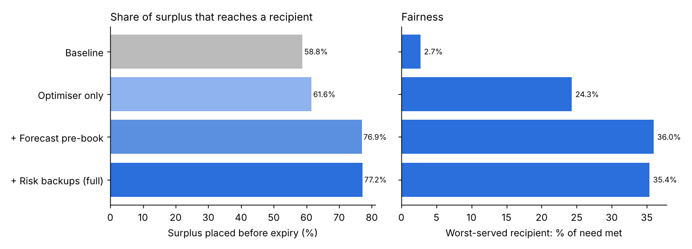
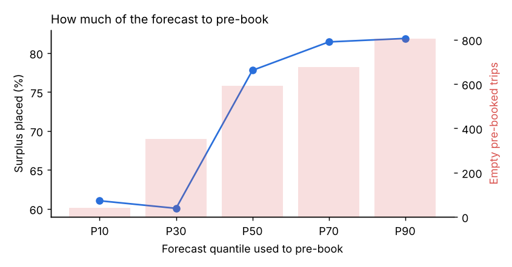
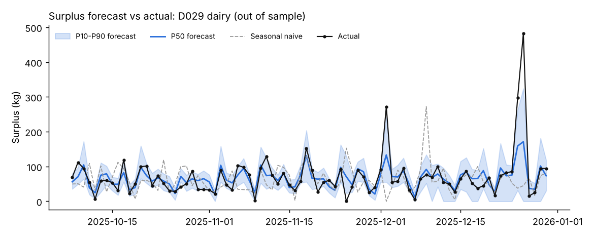

# Intelligent food redistribution: capstone prototype

A working prototype of the decision engine behind a surplus-food platform. Businesses donate surplus, charities receive it, volunteers collect it. The prototype answers three questions:

1. **How much surplus will each donor have tomorrow?** (surplus forecaster, quantile regression)
2. **Which recipient should get each listing?** (matching engine, constrained optimisation)
3. **Which collections are likely to fail?** (uncollected-listing predictor, classification)

It then runs all three together in a simulation and measures how much food reaches a recipient before it expires, compared with a simple baseline.

All data is synthetic. See [Data](#data) for why and how to plug in real sales data.

## Headline results

84 out-of-sample test days, 30 donors, 20 recipients, 60 volunteers, mean of 3 random seeds.

| Strategy | Surplus placed before expiry | Failed or unstaffed trips | Worst-served recipient (% of need met) |
| --- | --- | --- | --- |
| Baseline: surplus known at closing, nearest recipient | 58.8% | 59.2% | 2.7% |
| Optimiser only (same-day) | 61.6% | 16.6% | 24.3% |
| + Forecast pre-booking (P50) | 76.9% | 7.3% | 36.0% |
| + Risk-based backup volunteers (full pipeline) | 77.2% | 6.9% | 35.4% |

The full pipeline places about **19,400 kg more food** than the baseline over the 12-week test, roughly 230 kg a day.



### What drives the gain

- **Forecasting is the biggest lever.** Knowing tomorrow's surplus lets the platform book volunteers a day ahead, when far more of them are free and fewer collections fail. The forecaster cuts mean absolute error by **58%** against the seasonal-naive baseline, and its P10–P90 band covers 87% of actuals.
- **The optimiser mainly buys fairness and efficiency.** On its own it places only slightly more food than nearest-recipient matching, but it lifts the worst-served recipient from under 3% to 24% of need and uses 40% fewer km, because it plans within the volunteer trips actually available.
- **Risk backups add little in this setup.** The predictor is useful (PR-AUC 0.43 vs a 0.20 base rate), but once trips are pre-booked most collections are already low-risk, and the spare volunteer slots it reserves cost almost as much as the backups save. This is a real finding worth discussing, not a failure of the model.
- **Pre-book more than the median.** Booking to the P70–P90 forecast placed 81–82% of surplus vs 78% at P50, at the cost of more empty pre-booked trips (single seed). The right quantile depends on how much an empty trip costs volunteers' goodwill.



## Components

| Module | What it does | Method | Baseline |
| --- | --- | --- | --- |
| `foodnet/data/generator.py` | Synthetic network: donors, sales, stock, surplus, recipients, need, volunteers, collection history | Stock = last week's same-day sales × safety buffer; surplus = stock − demand. Demand responds to weekday, season, weather, UK bank holidays, promotions | n/a |
| `foodnet/forecasting/surplus.py` | Tomorrow's surplus per donor × category | Gradient-boosted trees (scikit-learn `HistGradientBoostingRegressor`) with quantile loss at P10/P50/P90; lag, rolling, calendar and weather features | Seasonal naive (same weekday last week) |
| `foodnet/forecasting/need.py` | Daily need per recipient (light) | Gradient-boosted regressor | Mean of same weekday over the last 4 weeks |
| `foodnet/matching/engine.py` | Allocate listings to recipients | Mixed-integer / linear programme (SciPy `milp`, HiGHS): maximise kg placed, penalise distance and trips, max-min fairness term; cap on trips = free volunteer slots | Nearest compatible recipient with capacity |
| `foodnet/risk/predictor.py` | Probability a collection fails | Logistic regression and gradient-boosted classifier; best by PR-AUC is used | Always predict "collected" |
| `foodnet/simulation/simulate.py` | End-to-end comparison of strategies | Day-by-day simulation with common random numbers across strategies | Baseline strategy |

**Food safety is a hard constraint, never a score:** chilled food only goes to recipients with chilled storage, meat only to recipients that accept it, and every trip must leave at least 8 hours of shelf life on arrival. The tests check this.

**Matching solver note:** the exact mixed-integer model hits a 10-second limit per day, which is too slow for thousands of simulated days. The default is LP-and-round (solve the relaxation, keep the largest flows as trips, re-solve), which runs in about 0.04 s and was within about 5% of the exact solution's kg placed on spot checks. Pass `exact=True` to `optimise_allocation` for the full model.

## Detailed metrics

Surplus forecaster, rolling-origin backtest (4 folds × 21 days):

| Model | MAE (kg) | WAPE | P10–P90 coverage |
| --- | --- | --- | --- |
| Seasonal naive | 11.16 | 0.92 | n/a |
| GBM quantile | 4.68 | 0.39 | 0.87 |

Need forecaster (last 84 days): 4-week mean MAE 19.6 kg (WAPE 0.173) vs GBM 18.7 kg (0.165). The baseline is close, which is why the simulation uses it.

Risk predictor (time split, latest 20% as test, threshold 0.25):

| Model | PR-AUC | ROC-AUC | Precision | Recall |
| --- | --- | --- | --- | --- |
| Always collected | 0.20 | 0.50 | n/a | 0 |
| Logistic regression | 0.43 | 0.73 | 0.38 | 0.55 |
| Gradient boosting | 0.42 | 0.73 | 0.38 | 0.53 |

Logistic regression edges out boosting because the synthetic failure process is itself logistic. Expect boosting to do better on real, messier data.

All tables are written to `results/` as CSV on each run.



## Run it

Requires Python 3.10+.

```bash
pip install -r requirements.txt
python scripts/run_all.py --quick   # small network, about 20 seconds
python scripts/run_all.py           # full run, about 3 minutes
python -m pytest -q                 # 8 tests, about 5 seconds
```

`run_all.py` regenerates the data in `data/` (git-ignored) and writes every table and chart to `results/`. The notebook `notebooks/walkthrough.ipynb` steps through each component interactively.

## Data

No public dataset records surplus donations at item level, so the generator builds a realistic stand-in. Every assumption is in `foodnet/config.py` (shelf lives, donor and recipient types, volunteer availability, speeds, distance caps) so results can be stress-tested.

To train the forecaster on real sales, replace `make_sales_history` with a loader for the [Corporación Favorita](https://www.kaggle.com/c/favorita-grocery-sales-forecasting) or [M5](https://www.kaggle.com/c/m5-forecasting-accuracy) Kaggle datasets that returns the same columns (`date, donor_id, donor_type, category, demand_units, stock_units, surplus_kg, promo`, plus the calendar columns). Both need a Kaggle account; check licence terms before publishing results.

## Limitations and next steps

- Results reflect the generator's assumptions. Report them as "under these conditions" and vary the parameters in `config.py`.
- Volunteer availability and failure behaviour are modelled, not observed. A small anonymised sample from a real food-sharing charity would anchor them.
- Empty pre-booked trips are counted but not costed. Adding a volunteer-goodwill cost would make the P50 vs P90 choice a proper trade-off.
- The P30 sensitivity point dips below P10 on a single seed; run more seeds before drawing conclusions about low quantiles.
- Phase two: collection route planning (vehicle routing with time windows), photo and text intake, an agent coordinator over WhatsApp/SMS, household sharing hubs, and an impact dashboard (meals, kg, CO₂e).

## Project layout

```
foodnet/
  config.py                 assumptions for the synthetic network
  data/generator.py         synthetic data
  forecasting/surplus.py    surplus forecaster + backtest
  forecasting/need.py       need forecaster
  forecasting/metrics.py    MAE, WAPE, pinball loss, coverage
  matching/engine.py        greedy baseline + optimiser
  risk/predictor.py         uncollected-listing predictor
  simulation/simulate.py    end-to-end strategy comparison
scripts/run_all.py          one command: data -> models -> simulation -> results
notebooks/walkthrough.ipynb interactive tour
tests/test_pipeline.py      reproducibility, leakage, safety constraints, model sanity
results/                    tables and charts from the last full run
```
